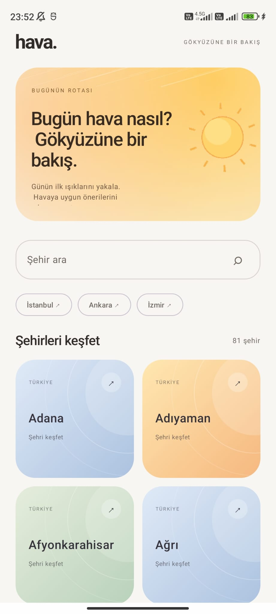
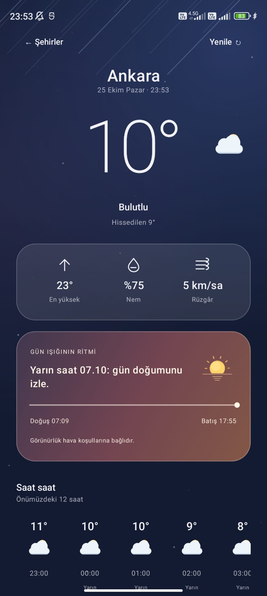
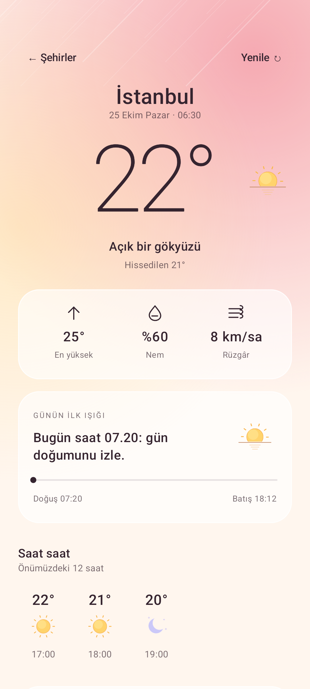
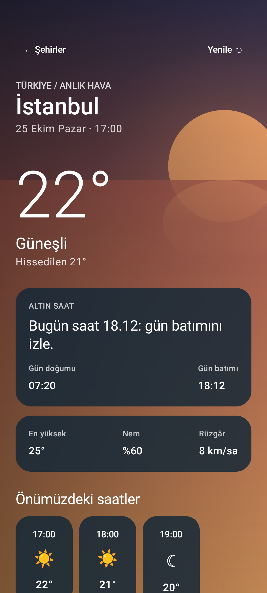

# hava. ☀️

**Gökyüzüne bir bakış.**

**hava.**, Türkiye'nin 81 ili için geliştirilmiş, Kotlin ve Jetpack Compose tabanlı bir Android hava durumu uygulamasıdır.

Uygulama, güncel hava durumunu ve saatlik tahminleri sade bir arayüzle sunarken, hava koşullarını ve günün farklı zamanlarını görsel deneyimin bir parçası haline getirmeyi amaçlar.

## ✨ Özellikler

- **81 il için hava durumu:** Şehirleri renkli kartlar üzerinden keşfetme ve arama yaparak istenilen şehre ulaşma.
- **Güncel hava bilgileri:** Sıcaklık, hissedilen sıcaklık, nem, rüzgâr ve saatlik hava durumu tahminleri.
- **Gün doğumu ve gün batımı deneyimi:** Şehrin yerel saatine göre gün doğumu ve gün batımı yaklaştığında değişen arayüzler, renk paletleri ve bilgilendirme mesajları.
- **Dinamik tasarım:** Gündüz, gece ve farklı hava koşullarına uyum sağlayan arka planlar ve görsel öğeler.
- **Günlük öneriler:** Hava koşullarına göre kullanıcıya sunulan kısa, günlük hayatta işe yarayabilecek öneriler.

## 📱 Uygulamadan Görüntüler

  
  
  
  

## 🛠️ Teknolojiler ve Mimari

Uygulama **Kotlin** ve **Jetpack Compose** kullanılarak geliştirilmiştir. Hava durumu ve konum verileri **Open-Meteo API** üzerinden alınmaktadır.

Proje geliştirilirken **MVVM mimarisi** ve **Separation of Concerns** ilkesi temel alınmıştır. Kullanıcı arayüzü, uygulama durumu ve veri erişimi ayrı sorumluluklar altında düzenlenerek daha anlaşılır ve sürdürülebilir bir kod yapısı oluşturulması hedeflenmiştir.

**Kullanılan teknolojiler:** Kotlin · Jetpack Compose · MVVM · Retrofit · Coroutines · StateFlow · Open-Meteo API

## 🌤️ Proje Hakkında

Bu proje, Android geliştirme ve Jetpack Compose üzerine çalışırken hem API entegrasyonu hem de katmanlı mimari konusunda pratik yapmak amacıyla geliştirildi.

Geliştirme sürecinde özellikle iki noktaya odaklandım: şehir seçim ekranını alışılmış listelerden farklı bir şekilde tasarlamak ve gün doğumu ile gün batımı gibi anları kullanıcı arayüzüne yansıtarak hava durumu deneyimini daha ilgi çekici hale getirmek.

Proje, tasarım ve kullanıcı deneyimi açısından geliştirilmeye açıktır.

---

*Made with Kotlin & Jetpack Compose.*
